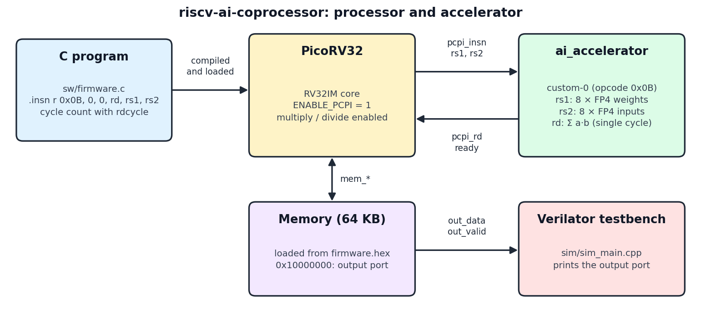

# riscv-ai-coprocessor

A small SIMD accelerator for AI workloads, attached to the PicoRV32 RISC-V core through its PCPI interface. With a single custom instruction, the accelerator computes the dot product of two 8-element vectors of 4-bit values in one clock cycle. This speeds up the inner loop of operations such as convolution and matrix multiplication (GEMM).

The hardware is written in Verilog and simulated with Verilator; the test programs running on the processor are written in C.

## How it works



- **Custom instruction:** uses the RISC-V `custom-0` opcode space (`0x0B`). It is called from C with inline assembly:
  ```c
  asm volatile (".insn r 0x0B, 0, 0, %0, %1, %2" : "=r"(result) : "r"(weights), "r"(inputs));
  ```
- **Data format:** `rs1` and `rs2` each hold eight 4-bit values. Value table: ±{0, 0.0625, 0.125, 0.25, 0.5, 0.75, 1.0, 1.5} (an E2M1-like FP4 format).
- **Hardware:** the values are converted to fixed point (1.0 = 16), the eight products are computed in parallel and summed. The result is returned in `rd` as an integer scaled by 256.
- **Processor:** PicoRV32 with multiply and divide enabled (`ENABLE_MUL`, `ENABLE_DIV`) and 64 KB of memory. The program is loaded into memory from `sw/firmware.hex`.

## Files

| File | Contents |
|---|---|
| `rtl/ai_accelerator.v` | FP4 SIMD accelerator (PCPI coprocessor) |
| `rtl/picorv32.v` | PicoRV32 RISC-V core (YosysHQ) |
| `sim/top.v` | Top module: processor + accelerator + memory |
| `sim/sim_main.cpp` | Verilator testbench; prints whatever the program writes to the output port |
| `sw/firmware.c` | Test program running on the processor |
| `sw/start.S`, `sw/sections.lds` | Startup code and linker script |
| `sw/makehex.py` | `firmware.bin` → `firmware.hex` converter |
| `sw/gen_model.py` | Generates random FP4 test data and Python reference results (`model_data.h`) |

## Build and run

**Requirements** (Linux or WSL recommended):
- RISC-V GCC toolchain (`riscv64-unknown-elf-gcc` or `riscv32-unknown-elf-gcc`)
- Verilator
- Python 3 and NumPy (for `gen_model.py`)

Example setup on Ubuntu:
```bash
sudo apt install gcc-riscv64-unknown-elf verilator python3-numpy
git clone https://github.com/SalihAlici/riscv-ai-coprocessor.git
cd riscv-ai-coprocessor
```

```bash
# 1) Build the software and generate the memory image
cd sw
riscv64-unknown-elf-gcc -march=rv32im -mabi=ilp32 -nostdlib -O2 -T sections.lds start.S firmware.c -o firmware.elf
riscv64-unknown-elf-objcopy -O binary firmware.elf firmware.bin
python3 makehex.py firmware.bin > firmware.hex

# 2) Build and run the simulation
cd ../sim
verilator --cc --exe --build -Wno-fatal top.v ../rtl/picorv32.v ../rtl/ai_accelerator.v sim_main.cpp
./obj_dir/Vtop
```

To record a waveform, enable the `trace` lines in `sim_main.cpp`; the output is written to `waveform.vcd`.

## Tests and results

The following tests were run during development (see the commit history):
- PicoRV32 simulation and assembly test.
- **Accelerator vs. software:** in the INT4 version, the same dot product took 2180 cycles in software and 92 cycles with the accelerator (about 23.7× faster; cycles measured with `rdcycle`).
- 128-element array test.
- Matrix multiplication (GEMM) test.

The current `firmware.c` runs an image processing demo: it performs edge detection on a 32×32 grayscale image and draws the result in the console as ASCII art.

## License

`rtl/picorv32.v` belongs to YosysHQ's PicoRV32 project (ISC license).
